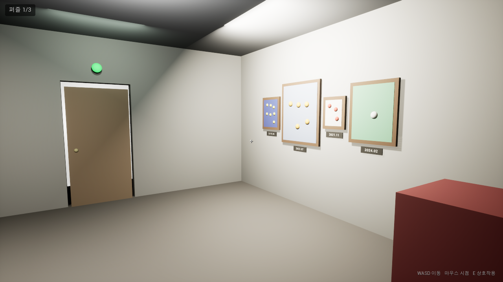
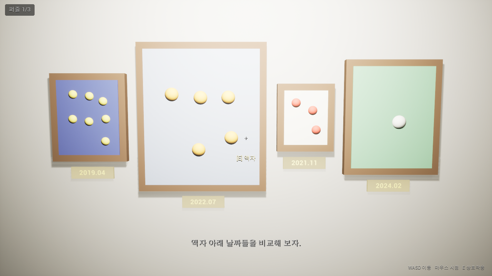
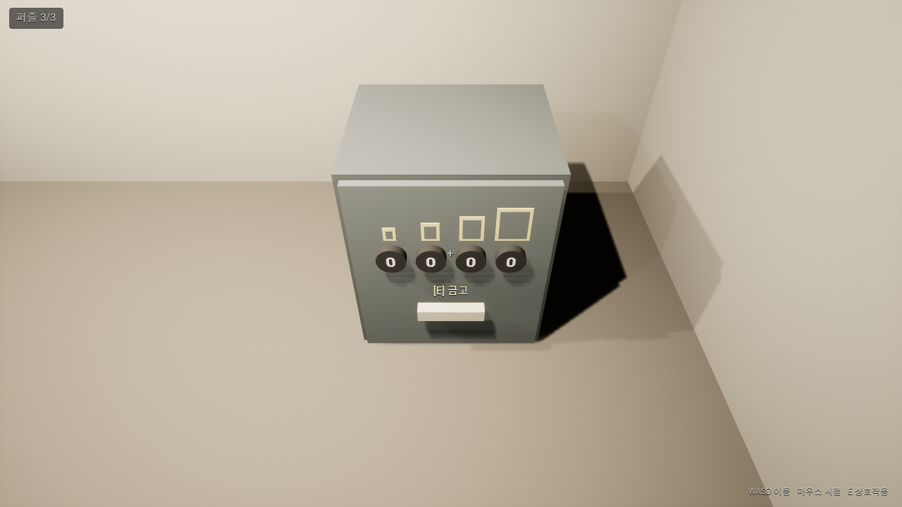

# Session Analytics (UE5 Plugin)

A lightweight Unreal Engine 5 plugin that collects gameplay/UI events per session and exports them to CSV.

Built to solve problems I hit while instrumenting a real-time UE5 product:
duplicate events from repeated UI callbacks, events fired before a session existed,
and analytics code tangled with gameplay Blueprints.

## Features
- `GameInstanceSubsystem`: one session per game instance, no actor to place in levels
- Automatic `session_start` / `session_end` events (end reason + suppressed duplicate count)
- Duplicate suppression: same event + same params inside a configurable window is dropped
- Order-independent param serialization (sorted keys) so duplicates are detected reliably
- Buffered, append-only CSV writing with RFC 4180 escaping; failed writes are retried on the next flush
- Events are flushed every N seconds (default 2), when the buffer reaches a threshold, and on session end
- Every call returns a result (`Recorded` / `Duplicate` / `NoSession` / `InvalidName`) so callers can verify what happened
- Blueprint-friendly API and Project Settings page

## Repository layout
- `Plugins/SessionAnalytics/` – the plugin (source, tests, settings)
- `Source/SessionAnalyticsDemo/` – demo module with `AAnalyticsDemoActor`, which fires a scripted set of events including one duplicate
- `Content/Maps/AnalyticsDemo.umap` – demo map (one `AnalyticsDemoActor`); `Scripts/create_demo_map.py` recreates it headless
- `Content/EscapeRoom/` – escape-room prototype built on the plugin (see below); `L_Studio` is the default map
- Plugin demo: open `SessionAnalyticsDemo.uproject` with UE 5.8 (the plugin and demo also build on 5.7: right-click the .uproject > Switch Unreal Engine version), build, open `Content/Maps/AnalyticsDemo` and press Play, or run it directly:
  ```
  UnrealEditor.exe SessionAnalyticsDemo.uproject /Game/Maps/AnalyticsDemo -game -windowed
  ```
  The CSV appears under `Saved/Analytics/`.

## Escape room prototype
A 3-minute first-person escape room in a painter's studio, built to show the plugin in a real game loop.
Three puzzles run in sequence (find, combine, order). Hints come on request (H, two levels per puzzle) with a timed
safety net, and light up the relevant objects. Items (drawer key, palette, door key) are picked up with E. Every play
session is logged to CSV by this plugin: build info, puzzle start/solve with attempt counts, wrong answers, hints
(requested or automatic), items found and picked up, objects inspected, pause-menu use and the escape time.

Current version: **v5** (iterated from playtests, see below). Screenshots of v5: `Docs/EscapeRoom/v5/`.

| | | |
|---|---|---|
|  |  |  |
| The studio | A hint lighting up the date labels | Safe dials with a text-free order clue |

- **Play:** open the project in **UE 5.8** (the escape-room assets are saved in 5.8), open `Content/EscapeRoom/L_Studio`, press Play and click the viewport. WASD to move, mouse to look, E to interact, H for a hint, Esc for the pause menu.
- **Code:** all gameplay logic is C++ in `Source/SessionAnalyticsDemo/EscapeRoom` (room manager, interactables, character, HUD).
  The Blueprints in `Content/EscapeRoom/Blueprints` are thin subclasses, so every tuning value (hint delays, safe code, hint and light tags) is editable in the Details panel.
- **Autoplay (development builds only):** the console command `Escape.Autoplay [hintDelaySeconds] [quit] [topview]` plays the room start to finish through the real E trace
  (including hint requests, the pause menu and quitting through it), takes screenshots into `Saved/Screenshots/EscapeRoom/` and leaves a full CSV.
  `topview` only takes a plan view. `Scripts/create_escape_room.py` rebuilds the level headless.
- **Guide (Korean):** `Content/EscapeRoom/README_EscapeRoom.md` explains the class roles, tuning values, events and how to play.
- **Playtests:** `Docs/Playtest/` holds the raw CSVs (v1: 3 plays, v2: 1, v4: 1, v5: 1), the v1 analysis (`analysis_v1.md`) and the change list of each
  version (`changes_v2.md`, `changes_v4_workpc.md`, `changes_v5.md`). Each change ties a playtest finding to a change, e.g. v4: a player held the
  drawer key for 82 s without noticing it → v5: keys are picked up with E and announced on screen → 2.1 s in the next play.
  Rerun the summary with `python Scripts/analyze_playtest.py Docs/Playtest/data/v1` (or another version folder).
  v3 and the first v4 were built on another machine and never pushed; v4 was rebuilt to the same spec (`changes_v4_workpc.md`).

## Install
1. Copy `Plugins/SessionAnalytics` from this repo to `<YourProject>/Plugins/SessionAnalytics`.
2. Regenerate project files, build, and enable **Session Analytics** in the Plugins window.
3. Options: **Project Settings > Plugins > Session Analytics**.

| Setting | Default | Meaning |
|---|---|---|
| `bAutoStartSession` | true | Start a session when the game instance starts |
| `DuplicateWindowSeconds` | 0.5 | Same event + params inside this window is a duplicate; 0 disables |
| `FlushThreshold` | 20 | Write to disk once this many events are buffered |
| `FlushIntervalSeconds` | 2.0 | Also write to disk this often; 0 disables |
| `OutputSubdirectory` | Analytics | Output folder under `Saved/` |

## Usage
Blueprint: `Get Game Instance Subsystem (SessionAnalyticsSubsystem)` → `Record Event`.

C++:
```cpp
if (auto* Analytics = GetGameInstance()->GetSubsystem<USessionAnalyticsSubsystem>())
{
	Analytics->RecordEvent(TEXT("color_selected"), { { TEXT("part"), TEXT("exterior") }, { TEXT("color"), TEXT("Red") } });
}
```

Output: `Saved/Analytics/<utc>_<sessionid>.csv`. Real output from the demo map (the second `Red` arrived inside the duplicate window and was dropped):
```
session_id,seq,timestamp_utc,elapsed_sec,event,params
C9F576A4-...,0,2026-10-14T01:34:02.128Z,0.000,session_start,
C9F576A4-...,1,2026-10-14T01:34:02.581Z,0.454,view_changed,view=exterior
C9F576A4-...,2,2026-10-14T01:34:02.704Z,0.576,color_selected,color=Red
C9F576A4-...,3,2026-10-14T01:34:02.946Z,0.819,color_selected,color=Blue
C9F576A4-...,4,2026-10-14T01:34:03.067Z,0.940,view_changed,view=interior
C9F576A4-...,5,2026-10-14T01:34:03.184Z,1.056,session_end,duplicates_suppressed=1;reason=DemoFinished
```

The `params` column is `key=value` pairs joined with `;`, sorted by key. A `\`, `;` or `=` inside a key or value
is written with a leading backslash (`\\`, `\;`, `\=`), so the column can always be split back unambiguously.

## Tests
Automation tests (`Session Frontend > Automation`, filter `SessionAnalytics`):
- `CsvEscape`: commas/quotes in params are CSV-escaped, keys are sorted
- `ParamEscape`: `\`, `;`, `=` inside params cannot be confused with separators
- `ParamOrderIndependence`: insertion order of params does not change the duplicate key
- `RecordAndDuplicate`: no-session, duplicate and invalid-name paths and the written row count
- `RecordAgainAfterWindow`: the same event is recorded again once the window has passed; window 0 disables suppression
- `FlushThreshold`: buffered events reach disk exactly at the threshold, on manual flush and on session end
- `SessionRestart`: restarting writes `session_end` (reason=Restart) to the old file and starts a fresh file and sequence

Headless run:
```
UnrealEditor-Cmd <Project>.uproject -ExecCmds="Automation RunTests SessionAnalytics; Quit" -unattended -nullrhi
```

Verified on UE 5.8.3 and UE 5.7.4 (Win64, Editor target): build OK, all 7 tests pass, demo map produces the CSV above.
A forced kill after 5 seconds still left `session_start` on disk thanks to the periodic flush.

## Design notes
- **Collection vs. output are separate.** Gameplay code only calls `RecordEvent`; buffering and file I/O live in the subsystem.
- **Duplicates are decided by content, not by caller.** UI widgets can fire the same callback several times; the subsystem filters that centrally.
- **Rejected events are reported, not hidden.** Events without a session return `NoSession` and log a warning instead of disappearing.
- **Loss on a crash is bounded.** Buffered events reach disk every `FlushIntervalSeconds`, so a crash or forced kill can lose
  at most the events of the last interval, plus the `session_end` row. A normal shutdown or `EndSession` writes everything.
